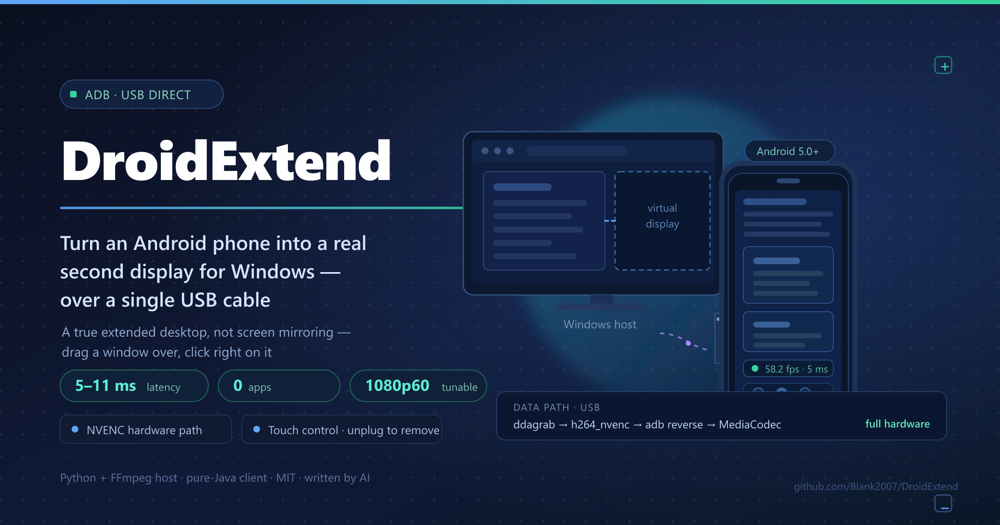

<p align="center">
  <a href="assets/intro-en.svg"></a>
</p>

<p align="center">
  <a href="README.md">简体中文</a> · <b>English</b>
</p>

<p align="center">
  <a href="https://github.com/Blank2007/DroidExtend/actions/workflows/ci.yml"></a>
  <a href="LICENSE"></a>
  <a href="https://github.com/Blank2007/DroidExtend/releases/latest"></a>
</p>

# DroidExtend — turn your Android phone into a Windows extended display over a USB cable

One USB cable, and your phone instantly becomes a second monitor for your PC: **not screen mirroring — a real extension of the desktop.**
You can drag windows off your laptop screen onto the phone and drive them with the mouse right there.

* Resolution, refresh rate, frame rate, bitrate and quality are **all configurable**
* Runs over the USB cable (adb) — **no Wi-Fi, no shared subnet, no third-party app to install**
* Host side: Python + ffmpeg (NVENC hardware encoding)
* Phone side: the bundled `dist/DroidExtend.apk`

---

> ### 🤖 The code in this repo was written by AI
>
> **Every line of source was written by an AI coding agent** — inside **DeepSeek Harness**, using the
> **deepseek-flash** model, written from scratch in a handful of sessions between 2026-10-10 and
> 2026-10-16; every release since
> (currently 1.6.3) has been maintained by it in this same repository.
> The human ([@Blank2007](https://github.com/Blank2007)) supplies the requirements, plugs in a real device, clicks
> "Yes" when admin rights are needed, and signs off on the result.
>
> The whole story — including every pitfall we hit and all the measured numbers — is in
> **[CHANGELOG.en.md](CHANGELOG.en.md)** (English; the Chinese original is **[开发日志.md](开发日志.md)**).
> Two of the bugs in there are, I think, worth a read:
> **a 100 ms delay caused by a single `p.stdout.read()`**, and **a display-configuration problem that only
> reproduced if you changed directories and turned out to be the AI session sandbox blocking it**.

**What makes it different**

| | |
|---|---|
| 🖥️ **A real extended desktop** | Not mirroring. A new display shows up under `Win+P`, windows can be dragged onto it, and the mouse can click right on it |
| 🔌 **Pure USB** | Runs over an `adb reverse` tunnel: no Wi-Fi, no shared subnet, no third-party app on the phone |
| ⚡ **Low latency** | Measured end to end at **5–11 ms** (from the host grabbing a frame to the phone decoding it); it was 31–42 ms before the fix |
| 👆 **Reverse control** | Taps / drags / a half-second hold = right click / two-finger scrolling on the phone are injected straight into Windows |
| 🧹 **Unplug the cable and it's gone** | Hit stop or pull the cable and the virtual display is removed from the system immediately — no ghost monitor left behind |
| 🎛️ **Fully hardware-accelerated pipeline** | `ddagrab` (desktop capture) → `h264_nvenc` (GPU encoding) → `MediaCodec` (phone hardware decoding); capture and encoding barely touch the CPU |
| 📦 **Works out of the box** | A 34 MB installer with ffmpeg / adb / the driver / the APK all inside — nothing else to prepare after installing |
| 🔄 **In-app updates** | "Check for updates" downloads the new version right there in the app and verifies size / SHA256 / file format — **if verification fails, it doesn't install**; no browser required |

> **Just want the ready-made binaries?**
> * Installer ⬇️ **[DroidExtend-Setup-1.6.3.exe](https://github.com/Blank2007/DroidExtend/releases/latest)** (35 MB)
> * Phone app ⬇️ **[DroidExtend.apk](https://github.com/Blank2007/DroidExtend/releases/latest/download/DroidExtend.apk)** (206 KB)
>
> You can also grab them from the [Releases](https://github.com/Blank2007/DroidExtend/releases) page.
> Note that the installer's **filename carries the version number**, so the link above points at the releases page
> rather than a direct download. This repository holds source only — the binary dependencies (ffmpeg, adb, the
> Android SDK, the virtual display driver) add up to 370 MB and are not checked in.

## What changed in each release

That lives in **[CHANGELOG.en.md](CHANGELOG.en.md)** (English) and its Chinese original
**[开发日志.md](开发日志.md)** — one section per version, with the measurements taken at the
time and the pitfalls hit along the way.
This document only covers how to use it.

---

## 0. Install (recommended — just keep clicking Next)

Double-click **`DroidExtend-Setup-1.6.3.exe`** → keep clicking "Next" all the way through.
**The very first page is "Select install location"**; it defaults to the directory below — click "Browse…" next to it
to put it somewhere else.

* Installs to `%LOCALAPPDATA%\Programs\DroidExtend` by default (changeable), **never asks for admin rights**, and
  works immediately after installing
* Creates Start menu and desktop shortcuts automatically; to remove it, click **卸载 DroidExtend** in the Start menu
* The installer is 34 MB and already packs ffmpeg, adb, the virtual display driver files and the phone app APK,
  so **there is nothing else to prepare after installing**

> The installer only writes files into your user directory — **it leaves the system alone**. The virtual display
> driver is a system-level component, so it is installed separately from a button in the app's UI (see step 1
> below); that is the step that triggers a UAC prompt.

---

## 1. Quick start (three steps)

### 1. Install the virtual display driver (once)

**If you used the installer**: open DroidExtend and click
**"Install virtual display driver (requires administrator)"** in the top left → click "**Yes**" on the UAC prompt.

**If you're using the portable build**: double-click **`安装虚拟显示器驱动.bat`** → likewise click "**Yes**".

About 10 seconds later, `device ROOT\DISPLAY\0001  status=OK` appearing in the log means it worked.

> Windows does not let any program conjure a display out of thin air: you have to install a kernel-level virtual
> display driver (IDD). This project uses the open-source **Virtual Display Driver 25.7.23**, which is signed and
> verified on a real machine here — no need to disable Secure Boot and no need to turn on test mode.

### 2. Plug the phone in and turn on USB debugging

* Settings → About phone → tap "Build number" 7 times to unlock developer options
* Developer options → turn on **USB debugging** and **Install via USB**
* Plug in the cable; when the phone asks "允许 USB 调试吗？" ("Allow USB debugging?"), tap **Allow**

### 3. Double-click `DroidExtend.exe`

**If you used the installer**, just open DroidExtend from the Start menu / desktop — don't worry about where the
exe lives.

Pick your resolution and frame rate in the window, then click **▶ 开始投屏** (Start casting).
The first run installs the APK onto the phone and launches it automatically; a few seconds later the phone is a
second screen.

> `DroidExtend.exe` is the portable main program (the `_internal\` folder next to it holds its runtime libraries —
> the two must stay together). `启动 DroidExtend.bat` launches the same program from source and is kept as a
> fallback: if the exe ever gets blocked by antivirus, double-clicking that does exactly the same thing.

> ⚠️ **If you're not using the installer, don't run the exe from inside an AI coding session's workspace
> directory.**
> The sandbox in such sessions blocks processes whose "program image lives under the workspace directory" from
> calling the display configuration APIs: the very same probe program returns `CDS_TEST rc=-1 / SDC_VALIDATE rc=5`
> when placed inside the workspace and `rc=0 / rc=0` when copied to any directory outside it (say `C:\Temp\probe`).
> The symptom is the log repeatedly filling with `激活显示器 attach rc=-1` (activate display attach rc=-1) and
> `attach 未生效，改用扩展拓扑 rc=5` (attach had no effect, falling back to the extend topology rc=5), after which
> the status turns to `出错` (error).
> The installer and manually copied builds both live outside the workspace and **do not have this problem**; the
> restriction also disappears once the AI session is closed, after which the exe runs from anywhere.
> (Launching from source is likewise unaffected, because the interpreter itself sits outside the workspace.)

---

## 2. The interface

The menu bar is at the top (**File / Tools / Help**), and the status bar at the bottom shows the version number, the
repository URL and where the settings file lives.
The left half of the middle area shows device and display status; the right half is where you tune quality and
frame rate.

| Item | Description |
| --- | --- |
| **Mode** | `拓展屏` (extend): create a new virtual display and grow the desktop; `镜像` (mirror): duplicate an existing display as-is |
| **Resolution / refresh rate** | The virtual display's real mode. **The menu lists exactly the modes the virtual display driver has** — the driver builds its mode table from every `<resolution>` row in `vdd_settings.xml` (11 of them here, × 30/60/90/120/144 Hz), and Windows rejects anything outside that table with `DISP_CHANGE_BADMODE`. Custom width and height still work |
| **Frame rate fps** | Encoding frame rate, 24 ~ 144 |
| **Bitrate cap Mbps** | Upper bound on the encoding bitrate; under VBR it's a ceiling, not a constant |
| **Rate control** | `VBR` (quality first — a static desktop uses almost no bandwidth) / `CBR` (constant bitrate, steadier on fast-moving content) |
| **Quality Q** | Lower is better quality and higher bitrate. `18~20` is essentially visually lossless; from `24` up you can see blocking |
| **Encoder** | Every entry is **actually test-encoded** before it is offered. Available here: `h264_nvenc` / `hevc_nvenc` / `av1_nvenc` (NVIDIA), `h264_amf` / `hevc_amf` (AMD), `libx264` / `libx265` (pure CPU fallback). Ones that are compiled in but cannot run on this machine (`*_qsv` and `av1_amf` here) are removed from the menu, and the log says so |
| **Capture** | `auto` picks ddagrab (Desktop Duplication API, zero-copy into NVENC); switch to gdigrab on older GPUs or if something misbehaves |
| **Screen position** | Place the virtual display to the right / left / above / below the primary screen |
| **Test the USB cable speed** | Measures how many Mbps this cable can actually do and clamps the bitrate cap to a safe value (stop the stream first for a more accurate reading) |
| **Stop** | Stops the stream and **removes the virtual display from the system** (see below) |

The bottom of the window shows live stats: `手机已连接  58.2 fps  编码 2.4 Mbps  送出 1203 帧  丢 0`
(phone connected / encoded / frames sent / frames dropped).

### Touch control

The image on the phone **can be touched directly** — touch points, swipes and scrolls are all injected into Windows
as real mouse events:

| Gesture | Effect |
| --- | --- |
| One-finger tap | Left click |
| Two taps in a row | Left double click |
| One-finger drag | Left-button drag (must clear the dead zone first, see below) |
| One-finger hold for half a second | Right click |
| Two-finger vertical swipe | Scroll wheel |
| Two-finger quick tap | Right click |

**Double click**: Windows only calls two clicks a double click when both land inside the same
4 × 4 pixel box — a number sized for a mouse, which a fingertip can never hit. So the host
**snaps the second press onto the first** (using the system's double-click time, half a second by
default, with a tolerance of about 58 px), and the phone releases a tap at the point it went down
rather than wherever the finger had drifted to. Three taps in a row work too.

**Touch dead zone**: a finger always wobbles a few pixels as it lands, and ignoring that makes
**every click arrive as a tiny drag**. So a one-finger move has to clear the system's own touch
threshold before it counts as a drag — until then not a single move event is sent. If the finger
moves during the half-second hold, the long press is cancelled and becomes a drag instead.

**Drags are paced to the frame rate**: position updates go out at most once every 16 ms (one frame
at 60 fps) — a move faster than the next frame is one nobody can see, so the stale intermediate
positions are dropped and **only the newest one is sent** (the host likewise injects only the newest
one). But **not one event is ever dropped** — down, up, right click and scroll all get through.

It runs over a **second adb reverse tunnel** (`tcp:27184`), so it never interferes with the video. The phone
normalizes touch points against the image's aspect ratio and sends 9-byte records; the host injects them with
`SendInput` in **absolute coordinates across the whole virtual desktop** — so when a touch lands on the virtual
display, Windows treats it as a real mouse on that display.

> Coordinates are normalized against the **entire virtual desktop**, and the program sets per-monitor DPI awareness
> at startup accordingly; so even if you set Windows scaling above 125%, touch points still line up.

### The virtual display disappears after you stop

When you press `停止` (Stop) — or close the window — the program **removes the virtual display from the desktop**:
the display is gone from Windows display settings, and the desktop width goes back from 4480 to 2560.

> This was the most annoying thing about the early versions — the old code only "restored the virtual display to
> its original resolution", so the screen stayed attached to the system forever.
> It now goes through `SetDisplayConfig(SDC_USE_SUPPLIED_DISPLAY_CONFIG)`, which removes only that one virtual
> display's path and **never touches your real external monitors**. The driver itself stays installed, and the next
> time you click `开始投屏` (Start casting) it is reattached automatically.

### Where settings and logs live

The two files always sit in **the same directory**:

* `settings.json` — the resolution / frame rate / bitrate / mode / screen position / window size you configured
* `DroidExtend.log` — the run log (the same lines you see in the UI log pane also land in this file; it rolls over
  to `.1` once it passes 2 MB)

By default that is **the program's own directory** — if you used the installer, it's the directory you chose during
installation.
The menu item `文件 → 更改数据目录…` (File → Change data directory…) moves it elsewhere (and takes both files along
with it), and `文件 → 打开数据目录（设置与日志）` (File → Open data directory (settings and logs)) opens it directly
in Explorer. The status bar at the bottom always shows which directory is in use.

> If the program directory is not writable (for example if you installed into `Program Files`), it automatically
> falls back to `%LOCALAPPDATA%\DroidExtend`, recording the choice in `data_dir.txt` inside that directory.
> Settings from before 1.4.0 lived in `%USERPROFILE%\.droidextend\settings.json` and are migrated automatically on
> first launch.

---

## 3. Performance and tuning (measured)

Measured on this machine (RTX 5070 Laptop + Redmi 24091RPADC, Android 16, 1920×1080@60):

```
capture ddagrab (desktop duplication) → h264_nvenc (GPU encode) → adb reverse → phone MediaCodec hardware decode
server: sent 1482 frames  dropped 0  bytes 7,614,539
phone:  Qin 304  Render 303  Drop 0  Avg 16ms/frame     ← every frame was rendered
```

**The bottleneck is the cable, not the software.** Use `测一下数据线速度` (Test the USB cable speed) to measure it
(ideally stop the stream first — the probe and the video compete for the same cable):

* On the same phone, swapping cables/ports makes a huge difference; three stages measured on this machine:
  * A charge-only cable → negotiated **USB 1.1 full speed, measured 13.7 Mbps**, and 1080p60 gets very blurry;
  * Swapping to a proper data cable → **measured 154.2 / 147.3 Mbps**;
  * Moving to a fast port → **measured 597 Mbps** (using incompressible random data; the phone itself reported
    receiving 56.0 MB in 0.79s).
    71 MB/s already exceeds USB 2.0's theoretical 60 MB/s ceiling, which means this cable is USB 3 class.
* How trustworthy the measurement is: the program makes **the phone report the actual number of bytes it received**
  and computes the rate as "total bytes ÷ total elapsed time (sending + draining)", so buffers can't fool it.
  By contrast, `adb push` numbers **cannot** be used as link speed (an all-zero file gets compressed — it once
  reported 1265 MB/s); `adb exec-out dd` only manages around 13 MB/s too, and that's the shell protocol's own
  ceiling.
* The default bitrate cap of **40 Mbps** is set for a decent everyday cable. It's a VBR ceiling, not a constant —
  a static desktop runs at only 1~2 Mbps, and only full-screen motion eats into that budget.
* With a fast enough link you can raise the cap to 80~120 Mbps directly; measured full-screen motion at 1080p60 with
  `画质 Q=20` (quality Q=20) only cost 2.3~2.7 Mbps (the content is just too simple), so **quality is mostly
  determined by Q — the bitrate cap is only a fuse**.
* If you're still on a slow cable, the program clamps the cap to a safe value after the speed test; you can also
  drop it to 8~10 Mbps manually.

Other tuning tips:

* **Prefer `h264_nvenc`**: ddagrab's D3D11 hardware frames feed straight into the encoder, so CPU usage is close to 0.
* **Screen tearing / dropped frames**: drop the frame rate to 30, or set the bitrate cap to 60% of the measured link
  speed.
* **Phone getting hot**: resolution and frame rate are the main factors; a phone running 1080p60 for a long time
  gets warm, which is normal.
* **A moment of black on first start**: ddagrab's frame 0 for every stream is a pure black frame; the program
  already drops it before encoding.

### Latency (measured)

Every 2 seconds the phone prints a line like `perf fps=… latency_avg_ms=… latency_max_ms=…`
(`adb logcat -s DroidExtend:I`). The timestamp is stamped by the host when it grabs the frame, and the phone
converts it using the clock offset established during the handshake, so what's measured is the **full path from
frame grab to decode**:

```
修复前 (before fix)  latency_avg_ms 31~42   latency_max 56~79
修复后 (after fix)   latency_avg_ms  5~11   latency_max 26~45
```

Where the difference came from: `capture.py` used `p.stdout.read(65536)` to pull ffmpeg's output. Python's
`BufferedReader` keeps reading until 64 KB are filled before returning, and in practice it **handed over 64 KB only
once every 200.0 ms on average** (after switching to `os.read` it hands over 4.6 KB every 13.7 ms) — in other
words, the picture sat idly in the buffer for roughly 100 ms before entering the encoding queue, and on the phone
side it showed up as "accumulate a batch, then render it all at once" (the `Render time interval reaches 154~258ms`
in logcat is exactly that).
It now uses `os.read(p.stdout.fileno(), 65536)`, which takes data the moment it's available.

### Diagnosing stutter, and why GPU usage looks high

**First work out which stage is struggling.** Turn on the status overlay on the phone; it shows
`fps` and `latency` live:

* `fps` low, `latency` normal → the **USB cable** is out of bandwidth. Run "Measure the cable speed"
  on the PC; below 40 Mbps, replace the cable (on the same phone we measured a 40× spread:
  13.7 Mbps ↔ 597 Mbps).
* `fps` normal, `latency` high (sustained > 80 ms) → the encoder or decoder is queueing. Pick a
  lighter encoder (`h264_nvenc` is the fastest on our machine), or drop to 30 fps.
* Both numbers fine but the image still stutters → the phone is thermal-throttling; see "Phone side".
* Even the PC's own mouse starts to lag → the GPU is saturated by something else; see below.

**High GPU usage is expected, and it follows directly from the virtual screen.** The virtual screen
is not a real panel, but the Windows desktop compositor (DWM) dutifully composites it like one —
the more pixels and the higher the refresh rate, the more it has to composite every frame. On top of
that, `ddagrab` (desktop duplication) pulls frames out of the GPU and the encoder reads them back
from it again. All of that lands on the graphics card, so a few percent to a low-teens percent of
steady GPU usage in Task Manager is by design, not a bug.
**Because of the virtual screen, GPU usage may be higher than you are used to.**

* To bring it down: **drop the resolution first, then the refresh rate** — the two multiply.
* Once the GPU really is saturated the virtual screen will start dropping frames. A different encoder
  will not help then; only fewer pixels will.
* `h264_nvenc` / `hevc_nvenc` / `av1_nvenc` use the dedicated encoder block on the card (NVENC) and do
  not compete with 3D rendering for compute. If you are worried about gaming, choose these three and
  not `libx264` (that one is pure CPU encoding).
* For what it's worth, the virtual screen's refresh rate does not have to match the primary display's.
  A 300 Hz primary with a 60 Hz virtual screen is fine, and cheaper.
* Do not move the virtual screen with third-party display tools. This program remembers the position
  itself, and an outside change is simply overwritten on the next launch.

**Phone side**: if the phone starts dropping frames as soon as it gets warm, the system is almost
certainly throttling. Charging over the cable makes it warmer, faster. You can:

* drop to 30 fps (in most content you will not see the difference);
* drop the resolution to 720p;
* exempt this app from battery optimisation in the phone's own settings (the app's settings panel has
  a button that jumps straight there).

**On "I changed the resolution and nothing happened"**: changing resolution / refresh rate / position
now applies **immediately** to a running virtual screen — no need to stop and restart. The program
retries up to four times and **judges success by the mode that actually took effect**, because Windows
briefly locks the display configuration while a mode change is in flight; the first attempt or two
failing is normal. If it never takes effect, check that "Follow the phone's resolution" is not ticked —
that option overrides your own choice.

**Why picking a size used to do nothing at all**: the virtual display driver does not accept arbitrary
sizes — it multiplies every `<resolution>` row in `vdd_settings.xml` by every refresh rate into one flat
mode table. A size outside that table comes back from `ChangeDisplaySettingsEx` as
`DISP_CHANGE_BADMODE` (-2) and the picture does not move. The old menu listed twenty-two hard-coded
sizes, eleven of which had no mode row behind them. The menu is now built from the driver's own table,
so a size it cannot produce is not offered; and if a request still misses, the log says the driver does
not have it — and the program no longer **waits nine seconds retrying, or restarts the picture for a
mode that never existed**. When the driver's table still has room, the missing size is written into
`vdd_settings.xml` and you are told to reinstall the driver (or reboot) to use it.

---

## 4. Directory layout

```
droid-extend/
├─ DroidExtend.exe                ← normally you just double-click this
├─ _internal/                     ← the exe's runtime libraries; must stay next to the exe
├─ 启动 DroidExtend.bat           ← launch the same program from source (fallback)
├─ 安装虚拟显示器驱动.bat         ← run once on first use (requires administrator)
├─ 构建手机端 APK.bat             ← only needed if you changed the phone-side Java code
├─ dist/
│   ├─ DroidExtend.apk           ← phone-side package
│   └─ DroidExtend-Setup-1.6.3.exe ← Windows installer (35 MB)
├─ tools/installer/
│   └─ DroidExtend.iss           ← Inno Setup script for the installer
├─ host/                          ← Windows side (Python)
│   ├─ app.py                    the GUI main program
│   ├─ session.py                one casting session: display → capture → encode → USB → phone
│   ├─ capture.py                ffmpeg command line, ddagrab output probing, H.264 access unit splitting
│   ├─ server.py                 TCP streaming server (handshake + frame queue + drop policy)
│   ├─ touch.py                  touch injection service (SendInput absolute coordinates)
│   ├─ win_display.py            CCD / ChangeDisplaySettingsEx wrappers (display control at the cpp level)
│   ├─ vdd.py                    virtual display driver install and status checks
│   ├─ adb.py                    adb wrappers (reverse tunnels, install, launch)
│   ├─ linkspeed.py              USB link speed test
│   ├─ paths.py                  locate the bundled adb / ffmpeg / JDK / SDK, plus the data directory
│   ├─ settings.py               settings I/O (atomic write + allowlist + migration from the old location)
│   ├─ applog.py                 writes DroidExtend.log (2 MB rollover, and a failure never takes the program down)
│   ├─ update.py                 checks GitHub for the latest Release
│   ├─ manual.py                 the body text of the in-app user manual
│   └─ version.py                version number and repository URL (change once, applies everywhere)
├─ android/                       ← phone side (pure Java, no Gradle)
│   ├─ src/com/droidextend/MainActivity.java
│   ├─ src/com/droidextend/StreamClient.java
│   ├─ src/com/droidextend/VideoDecoder.java
│   ├─ src/com/droidextend/InputClient.java
│   ├─ src/com/droidextend/HudView.java      status overlay + draggable settings button (all hand-drawn)
│   ├─ src/com/droidextend/Stats.java        per-frame statistics
│   ├─ src/com/droidextend/AppLog.java       logging switch and file output
│   ├─ src/com/droidextend/Prefs.java        three toggles + button position
│   ├─ AndroidManifest.xml
│   └─ build.py                  one-shot build: aapt2 → javac → d8 → package → apksigner
├─ tools/                         ← bundled toolchain and install scripts
│   ├─ platform-tools/adb.exe
│   ├─ ffmpeg/bin/ffmpeg.exe
│   ├─ sdk/                      Android build-tools 34.0.0 + platform 34
│   ├─ vdd/                      Virtual Display Driver driver files + nefcon
│   └─ vdd_install.ps1           driver install script (administrator)
├─ assets/                        ← the intro artwork (one per language: SVG source + PNG exports)
├─ README.md                      ← the Chinese README
├─ README.en.md                   ← this file (English)
├─ 开发日志.md                    ← the development log (Chinese)
├─ CHANGELOG.en.md                ← the English version of the above
├─ AGENTS.md                      ← notes for the next person or AI touching this repo
└─ 第三方组件许可.txt             ← the licence notice shipped with the installer
```

---

## 5. How it works

```
┌──────────── Windows host ──────────────┐         ┌──── Android ────┐
│ virtual display driver (IDD)           │         │                 │
│       ↓ desktop duplication (ddagrab)  │         │  SurfaceView    │
│   ffmpeg + NVENC hardware H.264        │         │       ↑         │
│       ↓ access units (Annex-B)         │  USB    │  MediaCodec     │
│   TCP 127.0.0.1:27183 ─────────────────┼────────→│  hardware decode│
│   TCP 127.0.0.1:27184 ←────────────────┼─────────│  touch events   │
└────────────────────────────────────────┘ adb     └─────────────────┘
                                      reverse
```

1. **`win_display.py`** uses the Windows CCD API to activate the virtual display and place it next to the primary
   screen, then sets it to the resolution/refresh rate you picked with `ChangeDisplaySettingsEx`; on stop it uses
   `SetDisplayConfig(SDC_USE_SUPPLIED_DISPLAY_CONFIG)` to remove only that one virtual display path.
2. **`capture.py`** grabs that rectangle from the Desktop Duplication API with ddagrab — the D3D11 texture goes
   straight into NVENC with no memory copy; at startup it first probes the mapping from `output_idx` to display and
   drops the leading black frame.
   It reads ffmpeg's output with `os.read()` instead of `read()`, so the 64 KB buffer doesn't push latency up to
   ~100 ms.
   ddagrab only knows DXGI **output indices** (not device names, and it has no desktop-coordinate option), while
   resolution **is not an identity**: `1920x1080` is both the most common laptop panel in the world and the virtual
   display's default. So when several outputs share the same size, the program uses gdigrab to capture the desktop
   rectangle the virtual display occupies and compares it pixel by pixel against a thumbnail of each candidate
   output — only the real one matches. **If it can't tell them apart it falls back to grabbing with gdigrab by
   desktop offset (slower, but always correct) — it never guesses output 0**, because guessing wrong means pushing
   your laptop's own screen to the phone.
3. The encoded raw H.264 is split into access units and sent to the phone through the tunnel established by
   **`adb reverse tcp:27183`** (the phone connects to its own `127.0.0.1:27183`, so it **runs entirely over USB with
   no Wi-Fi needed**).
   Every frame carries a host timestamp, from which the phone computes and displays the end-to-end latency.
4. On the phone, **`VideoDecoder.java`** pulls the SPS/PPS out of the stream itself to configure MediaCodec, and
   renders the hardware-decoded output straight to a `SurfaceView`; whenever the backlog exceeds 384 KB it drops
   through to the next keyframe to keep latency low.
5. Touch events travel back over **`tcp:27184`**: the phone normalizes coordinates against the image's aspect
   ratio → the host's **`touch.py`** injects them with `SendInput` in absolute coordinates across the whole virtual
   desktop, as a real mouse.

---

## 6. FAQ

**Q: I have **v1.4.0 or earlier** installed and clicking "Install virtual display driver (requires administrator)" does nothing?**
A: That's a fixed bug ([issue #1](https://github.com/Blank2007/DroidExtend/issues/1), thanks to
[@Bai-2008](https://github.com/Bai-2008) for reporting it): in v1.1.0–v1.4.0 the driver install script had the
developer machine's path hard-coded, so it failed for every user, and the failure message was swallowed by the
elevated child process, leaving the UI showing nothing at all.
**Upgrade to v1.4.1 and you're done.** To verify: after installing the driver you should see `MttVDD` in
"Device Manager → Display adapters"; and `source missing` should no longer appear in the log file
(`文件 → 打开数据目录`).
As a manual fallback, right-click `安装虚拟显示器驱动.bat` → "Run as administrator"; it drives the very same
script as the button.

**Q: The driver is installed and `MttVDD` is right there in Device Manager, but the moment I click "Start casting"
it says "虚拟显示器无法激活（未上桌面）" (the virtual display can't be activated / not on the desktop)?**
A: That's a bug in **v1.5.0 and earlier**, and it's fixed. The cause was that the
**`vdd_settings.xml` shipped with the driver listed too many mode combinations**: the driver multiplies "each
resolution × each refresh rate" into one flat table and hands it to Windows, and that table has a fixed-size
buffer; ours had 22 × 5 = 110 combinations, and past the limit `IddCxMonitorArrival` gets rejected by the system
(`STATUS_NOT_SUPPORTED`), so the adapter comes up and the monitor object is created, **but there is simply no such
display on the desktop** — which makes any call to set a resolution or attach a display fail by construction.

**Upgrade to v1.5.1 and you're done.** That release compresses the mode table to 11 × 5 = 55 combinations, adds a
hard cap to `add_resolution`, and the install script now resets the table automatically when it finds one that's
too large. On a machine that's already affected, clicking
**"Install virtual display driver (requires administrator)"** once fixes it (effective after the device restarts).
To check for yourself: in the log under `工具 → 检查更新` (Tools → Check for updates), the driver-ready line shows
the mode count.

**Q: How do I upgrade to a new version?**
A: `工具 → 检查更新` (Tools → Check for updates). The program reads the latest version number from GitHub, lists the
release notes when there's something newer, and "Download and install" **downloads, verifies, installs and restarts
all inside the app** — you never have to go hunting for the installer in a browser.
Before downloading it checks, in order: the URL must be an official GitHub domain (https), the official source must
publish a SHA256, the byte count must match the official one, the SHA256 must match, and the file must start with
`MZ` — **if any check fails it does not install**, and it tells you right there which one failed.

**Q: The updater says "this program has no code signing certificate" — is that unsafe?**
A: That's the truth, and it needs saying plainly: this project has not bought (and does not intend to buy) a code
signing certificate, so Windows will not stamp the installer as "signed", and the program **will not pretend**
otherwise — the update confirmation dialog says so outright.
Actual integrity rests on **checksums**: the SHA256 comes from both the GitHub API's `digest` field and the checksum
table in the release body, and both must agree before anything is installed. That stops tampered downloads,
man-in-the-middle package swaps, and proxies returning truncated files — but it does not stop a premise-level attack
in which "the GitHub repository itself is controlled by someone else".
If that bothers you, download manually from the [Releases](https://github.com/Blank2007/DroidExtend/releases) page
and check the SHA256 yourself.

**Q: The phone only shows a wallpaper and a taskbar, looking exactly like the main screen?**
A: That is precisely what a **successful extension** looks like — a newly attached display defaults to the same
wallpaper, and Windows draws another taskbar on it, so an empty extended display looks identical to the primary at
a glance. Your windows are on the **primary** screen, so of course the phone doesn't show them: drag any window
toward the extended display (to the right of the primary by default) and that window appears on the phone
immediately. The log line
`拓展屏就绪: \\.\DISPLAY20 -> 1920x1080@60 at (2560,0)` (extended display ready …) is its desktop coordinate, and
`投屏已开始: extend …` (casting started: extend …) means this is the display being streamed.

**Q: The phone is black / only shows status text?**
A: The phone locked its screen. Press the power button to wake it and unlock it; the app reconnects automatically
(retrying every 700 ms).

**Q: It keeps saying "等待手机连接…" (waiting for phone to connect)?**
A: Run `adb devices` and look for `unauthorized` — that means nobody tapped Allow on the phone. You can also click
"Refresh" in the UI.

**Q: I clicked start casting but the desktop didn't change?**
A: Look for the `ChangeDisplaySettingsEx -> SUCCESSFUL` line in the log.
If it says `FAILED`, the resolution usually isn't in the driver's mode table; the program automatically picks the
nearest available mode and records that in the log.

**Q: The desktop layout is a mess after stopping?**
A: Normally `停止` (Stop) removes the virtual display from the system and the desktop width shrinks back on its own.
If the process gets **force-killed** partway through (ended from Task Manager, or the cable is yanked), the virtual
display may stay in the system — just run `DroidExtend.exe` again and click `开始投屏` (Start casting) followed by
`停止` (Stop) to clean it up; you can also set it to "Disconnect this display" in Display settings.

**Q: Touch doesn't respond?**
A: First check whether the phone app's status bar shows a latency number (that means the tunnel is up). Touch runs
over `tcp:27184`, and `adb reverse` stops working after you replug the cable; clicking `刷新` (Refresh) in the UI
rebuilds both tunnels.

**Q: Do I need to rebuild anything if I switch phones?**
A: No. The protocol and the resolution are both negotiated at runtime, and any Android 5.0+ arm64/arm phone can
install it.

---

## 7. Rebuilding the phone side (optional)

Only needed if you changed the Java code under `android/src/**` or the resources under `android/res/**`:

```
构建手机端 APK.bat            ← double-click it in Explorer
```

It runs the whole pipeline with the aapt2 / javac / d8 / apksigner from the bundled `tools/sdk`, and the output
overwrites `dist/DroidExtend.apk`. No Android Studio and no Gradle required.

Two easy traps:

* Resources must first be compiled into a `res.zip` with **`aapt2 compile --dir android\res`**, and that zip is then
  passed to `aapt2 link` as a positional argument; you also have to give `link` **`--java <dir>`** for `R.java` to be
  generated — without it, any code using `R.color.xxx` fails to compile with `找不到符号 R` (cannot find symbol R).
  The generated `R.java` must be handed to javac as well.
* The version number lives only in `AndroidManifest.xml`. Do **not** also pass `--version-code/--version-name` on the
  command line, or you'll have a second source of truth, and sooner or later the two will disagree.
* The signing key is at `android/droidextend.keystore` (not inside `android/build/`, because `--clean` deletes that
  directory). Changing the key makes every subsequent install fail with `INSTALL_FAILED_UPDATE_INCOMPATIBLE`, so you
  have to uninstall first — though `install()` in `host/adb.py` already calls `uninstall()` and reinstalls
  automatically when it hits that error.

The icons (`android/res/mipmap-*` and `DroidExtend.ico`) are drawn, not sourced:

```powershell
# the interpreter below is the one bundled with DSH — C:\Python314 has no PIL
& "<path to a python.exe that has Pillow>" android\make_icon.py
```

Same story for the Windows exe: you only need to rebuild it if you changed the Python code under `host/**`
(requires `pyinstaller`):

```powershell
cd <repository directory>
python -m PyInstaller --noconfirm --clean --onedir --windowed `
  --name DroidExtend --icon ".\DroidExtend.ico" `
  --paths ".\host" `
  --distpath ".\tools\pybuild\out" `
  --workpath ".\tools\pybuild\work" `
  --specpath ".\tools\pybuild" `
  ".\host\app.py"
# then copy out\DroidExtend\DroidExtend.exe and out\DroidExtend\_internal\ to the project root
```

You must use `--onedir` rather than `--onefile`: a single-file build self-extracts into `%TEMP%` on every launch,
and in a restricted environment it fails outright with `Could not create temporary directory!`.

---

## 8. Rebuilding the Windows installer

After installing [Inno Setup 6](https://jrsoftware.org/isdl.php) (or running
`winget install --id JRSoftware.InnoSetup`):

```powershell
& "$env:LOCALAPPDATA\Programs\Inno Setup 6\ISCC.exe" ".\tools\installer\DroidExtend.iss"
```

The output overwrites `dist\DroidExtend-Setup-<version>.exe` directly (about 20 seconds, lzma2/max).

The script is at `tools/installer/DroidExtend.iss`; the key points:

* It packs only the files needed **at runtime**: `DroidExtend.exe`, `_internal\`, `tools\ffmpeg`,
  `tools\platform-tools`, `tools\vdd`, `tools\vdd_install.ps1`, `dist\DroidExtend.apk`.
  **`tools\sdk` (251 MB) and `tools\vdd\*.zip` are not packed** — they're only needed to rebuild the APK, and they
  are exactly what would blow the project up from 34 MB to 391 MB.
* It installs to `%LOCALAPPDATA%\Programs\DroidExtend` with `PrivilegesRequired=lowest`:
  the program writes adb's temporary files into `tools\tmp` at runtime, and under normal privileges it actually
  can't write there when installed into `Program Files`.
* The virtual display driver is a system-level component, so the installer **doesn't do it for you** — that's left
  to the elevated install button in the app's UI.
* The Chinese UI starts from the English `Default.isl` and overrides the strings in `[Messages]`
  (the official `ChineseSimplified.isl` download source was unavailable at the time); the script file must be saved
  as **UTF-8 with BOM**, or Inno parses it as ANSI and all the Chinese turns to garbage.
* When editing the script, note that the `[Setup]` section uses `=`, while the parameters of the
  `[Files] / [Icons] / [Run] / [Tasks]` sections use **`:`** — writing `Comment="…"` fails compilation immediately
  (`Unrecognized parameter name`).

---

## 9. Credits, contact and license

### Third-party components

This project stands on other people's shoulders; the components below **were not written by me**, and I thank them
all:

| Component | Purpose | License | Source |
| --- | --- | --- | --- |
| **Virtual Display Driver (VDD)** | Makes Windows genuinely gain an extra virtual display — the foundation of "a real extended desktop" | MIT | [VirtualDrivers/Virtual-Display-Driver](https://github.com/VirtualDrivers/Virtual-Display-Driver) |
| **nefcon** | Silent install/uninstall of device drivers (instead of opening Device Manager by hand) | MIT | [nefarius/nefcon](https://github.com/nefarius/nefcon) |
| **FFmpeg** | `ddagrab` desktop duplication + `h264_nvenc` hardware encoding (invoked as a separate process) | GPL-3.0 | [ffmpeg.org](https://ffmpeg.org/) |
| **Android SDK Platform-Tools (adb)** | Installing the phone-side APK and establishing the two `adb reverse` tunnels | Apache-2.0 | [developer.android.com](https://developer.android.com/tools/releases/platform-tools) |
| **R8 / D8** | Compiles Java to dex only **when building** the APK (not distributed at runtime) | BSD-3-Clause | [r8.googlesource.com/r8](https://r8.googlesource.com/r8) |
| **Python / Tcl-Tk** | The program itself and its GUI | PSF-2.0 / BSD-style | [python.org](https://www.python.org/) · [tcl.tk](https://www.tcl.tk/) |
| **PyInstaller** | Packaging into `DroidExtend.exe` | GPL-2.0 + bootloader exception | [pyinstaller.org](https://pyinstaller.org/) |
| **Inno Setup** | Generating the installer | Inno Setup License | [jrsoftware.org](https://jrsoftware.org/isinfo.php) |

The full license texts, copyright notices and exactly what is distributed for each component are written up in
**[`第三方组件许可.txt`](第三方组件许可.txt)** (Chinese; it ships inside the installer too, and you can open it from
`帮助 → 第三方组件许可` in the app). Licenses like MIT / Apache-2.0 / BSD all require that "the notice be included
when distributing binaries", so that file travels with the installer — it isn't optional.

This project's own code (the Python in `host/`, the Java in `android/src/`, the scripts in `tools/`, the icons and
the documentation) is released under the **MIT** license; see [LICENSE](LICENSE).
The icons are generated pixel by pixel in code by `android/make_icon.py` (the five `mipmap-*` densities on the phone
side and the root `DroidExtend.ico`); no off-the-shelf assets or fonts were used. `tools/make_icon.py` is a separate,
minimal version that writes only `DroidExtend.ico` with the standard library and no Pillow, kept as a fallback.

> ⚠️ **If you find your work used here without attribution, or an attribution/license written incorrectly, please
> contact me and I'll add it in the next release. If there's any infringement, contact me directly as well and I'll
> deal with it immediately.**

### Contact me

| | |
| --- | --- |
| 👤 **Author** | [@Blank2007](https://github.com/Blank2007) (Void_Blank) |
| 🐙 **GitHub** | Issues / suggestions / bug reports: [**Blank2007/DroidExtend/issues**](https://github.com/Blank2007/DroidExtend/issues) —— the fastest way to reach me |
| 💬 **GitHub Discussions** | You're also welcome to drop by the repository [home page](https://github.com/Blank2007/DroidExtend) and hit ⭐ or open a Discussion |
| 📧 **Email** | 1553008865@qq.com |
| 📧 **Backup email** | lsw1553008865@gmail.com |

### One last word

This software — from the first line of Python to the APK, from the icon to the installer, including this README —
was **written entirely by an AI coding agent (DeepSeek Harness / deepseek-flash) in a single session on 2026-10-10**.
The human ([@Blank2007](https://github.com/Blank2007)) supplied the requirements, set the direction, plugged in a real
device to test, and signed off. The whole process, every pitfall along the way and all the measurements are in
**[CHANGELOG.en.md](CHANGELOG.en.md)** (English) and **[开发日志.md](开发日志.md)** (the Chinese original).
