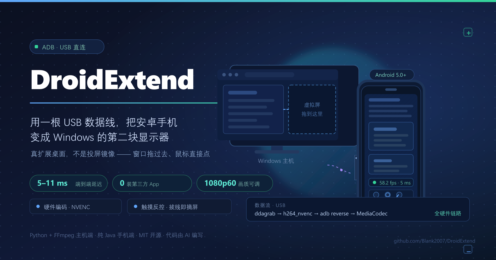

<p align="center">
  <a href="assets/intro-zh.svg"></a>
</p>

<p align="center">
  <b>简体中文</b> · <a href="README.en.md">English</a>
</p>

<p align="center">
  <a href="https://github.com/Blank2007/DroidExtend/actions/workflows/ci.yml"></a>
  <a href="LICENSE"></a>
  <a href="https://github.com/Blank2007/DroidExtend/releases/latest"></a>
</p>

# DroidExtend — 用数据线把安卓手机变成 Windows 的拓展屏

一根 USB 数据线，手机立刻变成电脑的第二块显示器：**不是投屏镜像，是真的扩展桌面**——
你可以把窗口从笔记本屏幕拖到手机上，鼠标直接在上面操作。

* 画质、帧率、分辨率、刷新率、码率**全部可调**
* 走 USB 数据线（adb），**不依赖 Wi-Fi、不需要同网段、不装任何第三方 App**
* 电脑端：Python + ffmpeg（NVENC 硬件编码）
* 手机端：随包附带的 `dist/DroidExtend.apk`

---

> ### 🤖 这个仓库的代码是 AI 写的
>
> **全部源代码由 AI 编码代理编写**——在 **DeepSeek Harness** 里、用 **deepseek-flash** 模型，
> 于 2026-10-10 至 2026-10-16 的几次会话内从零写完，此后每个版本（当前 1.6.4）都由它在同一个仓库里继续维护。
> 人类（[@Blank2007](https://github.com/Blank2007)）负责提需求、插上真机、在需要管理员权限时点“是”、以及验收。
>
> 整个过程（包括踩过的每一个坑和实测数据）记在 **[开发日志.md](开发日志.md)** 里，
> 里面有两个我觉得挺值得一读的 bug：**一行 `p.stdout.read()` 造成的 100 ms 延迟**，
> 以及**一个只有换目录才能复现、最后发现是 AI 会话沙箱在拦的显示配置问题**。

**它有什么特别的**

| | |
|---|---|
| 🖥️ **真扩展桌面** | 不是镜像投屏。`Win+P` 里会多出一块显示器，窗口能拖过去，鼠标能直接在上面点 |
| 🔌 **纯 USB** | 走 `adb reverse` 隧道，不依赖 Wi-Fi、不用同网段、手机端不装任何第三方 App |
| ⚡ **低延迟** | 端到端实测 **5–11 ms**（从主机抓到帧到手机上解出来），修复前是 31–42 ms |
| 👆 **能反控** | 手机上的点按 / 双击 / 拖动 / 长按 0.5 秒=右键 / 双指滚动，直接注入到 Windows |
| 🧹 **拔线即消失** | 点停止或拔掉数据线，虚拟屏立刻从系统里摘掉，不留幽灵显示器 |
| 🎛️ **全硬件链路** | `ddagrab`(桌面复制) → `h264_nvenc`(GPU 编码) → `MediaCodec`(手机硬解)，采集编码几乎不吃 CPU |
| 📦 **开箱即用** | 34 MB 的安装包，ffmpeg / adb / 驱动 / APK 全在里面，装完不用再准备任何东西 |
| 🔄 **程序内更新** | 「检查更新」直接在程序里下载新版本，校验大小 / SHA256 / 文件格式，**校验不过就不装**，不用自己跑浏览器 |

> **想直接拿现成的？**
> * 安装程序 ⬇️ **[DroidExtend-Setup-1.6.4.exe](https://github.com/Blank2007/DroidExtend/releases/latest)**（35 MB）
> * 手机端 App ⬇️ **[DroidExtend.apk](https://github.com/Blank2007/DroidExtend/releases/latest/download/DroidExtend.apk)**（206 KB）
>
> 也可以在 [Releases](https://github.com/Blank2007/DroidExtend/releases) 页面里下载。
> 注意安装包的**文件名带版本号**，所以这里给的是 releases 页面链接而不是直链。
> 本仓库只放源码 —— 二进制依赖（ffmpeg、adb、Android SDK、虚拟显示驱动）加起来 370 MB，没有进仓库。

## 各版本改了什么

放在 **[开发日志.md](开发日志.md)** 里（英文版：**[CHANGELOG.en.md](CHANGELOG.en.md)**），
一版一节，附带当时的实测数据和踩过的坑。这里只讲怎么用。

---

## 〇、安装（推荐，双击下一步就行）

双击 **`DroidExtend-Setup-1.6.4.exe`** → 一路“下一步”。
**第一个页面就是“选择安装位置”**，默认装在下面这个目录，想换地方点旁边的“浏览…”。

* 装到 `%LOCALAPPDATA%\Programs\DroidExtend`（默认值，可以改），**全程不请求管理员权限**，装完直接能用
* 自动建开始菜单和桌面快捷方式；想卸载就点开始菜单里的 **卸载 DroidExtend**
* 安装包 34 MB，里面已经打包好 ffmpeg、adb、虚拟显示器驱动文件和手机端 APK，
  **装完不需要再准备任何东西**

> 安装包只往你的用户目录里放文件，**不动系统**。虚拟显示驱动属于系统级组件，
> 由程序界面上的按钮单独装（见下面第 1 步），那一步才会弹 UAC。

---

## 一、快速开始（三步）

### 1. 装虚拟显示器驱动（只需一次）

**装过安装包的话**：直接打开 DroidExtend，点左上角的
**「安装虚拟显示器驱动（需要管理员）」** → 弹出 UAC 时点“**是**”。

**用免安装版的话**：双击 **`安装虚拟显示器驱动.bat`** → 同样点“**是**”。

大约 10 秒后日志里出现 `device ROOT\DISPLAY\0001  status=OK` 就成功了。

> Windows 不允许任何程序凭空多出一块屏幕，必须装一个内核级的虚拟显示驱动（IDD）。
> 这里用的是开源的 **Virtual Display Driver 25.7.23**，已签名，本机实测通过，
> 不需要关闭安全启动、也不需要开启测试模式。

### 2. 手机插上数据线，打开 USB 调试

* 设置 → 关于手机 → 连点“版本号”7 次开启开发者选项
* 开发者选项 → 打开 **USB 调试** 和 **USB安装**
* 插上数据线，手机上弹出“允许 USB 调试吗？”→ 点**允许**

### 3. 双击 `DroidExtend.exe`

**装过安装包的话**，从开始菜单／桌面打开 DroidExtend 就行，不用管 exe 在哪。

在窗口里选好分辨率和帧率，点 **▶ 开始投屏**。
第一次会自动把 APK 装到手机上并启动，之后几秒手机就变成第二块屏幕了。

> `DroidExtend.exe` 是免安装的主程序（旁边那个 `_internal\` 文件夹是它的运行库，
> 两个要放在一起）。`启动 DroidExtend.bat` 是同一程序的源码启动方式，保留备用：
> 万一 exe 被杀软拦了，双击它效果完全一样。

> ⚠️ **如果不用安装包，别把 exe 放在 AI 编码会话的工作区目录里运行。**
> 这类会话的沙箱会拦截「程序镜像位于工作区目录之下」的进程调用显示配置 API：
> 同一个探针程序放进工作区里返回 `CDS_TEST rc=-1 / SDC_VALIDATE rc=5`，
> 复制到工作区外的任意目录（例如 `C:\Temp\probe`）就返回 `rc=0 / rc=0`。
> 表现是日志里反复刷 `激活显示器 attach rc=-1`、
> `attach 未生效，改用扩展拓扑 rc=5`，最后状态变 `出错`。
> 安装包和手动复制的副本都在工作区之外，**没有这个问题**；
> 关掉 AI 会话之后这个限制也不存在了，放哪儿都能跑。
> （源码方式启动同样不受影响，因为解释器本身在工作区外。）

---

## 二、界面说明

顶部是菜单栏（**文件 / 工具 / 帮助**），底部状态栏显示版本号、仓库地址和设置文件位置。
中间左半边看设备和显示器状态，右半边调画质与帧率。

| 项目 | 说明 |
| --- | --- |
| **模式** | `拓展屏`：新建一块虚拟屏，桌面变大；`镜像`：直接复制现有某块屏幕 |
| **分辨率 / 刷新率** | 虚拟屏的真实模式。**下拉里列的就是虚拟显示器驱动真有的那些模式**——驱动从 `vdd_settings.xml` 的每一行 `<resolution>` 建模式表（本机 11 档 × 30/60/90/120/144 Hz），表外的尺寸 Windows 会以 `DISP_CHANGE_BADMODE` 直接拒掉。也可自定义宽高 |
| **帧率 fps** | 编码帧率，24 ~ 144 可选 |
| **码率上限 Mbps** | 编码码率上限，VBR 下是“天花板”而不是恒定值 |
| **码率控制** | `VBR`（质量优先，静止桌面几乎不占带宽）／`CBR`（恒定码率，剧烈运动画面更稳） |
| **画质 Q** | 越小画质越好、码率越高。`18~20` 基本视觉无损，`24` 以上能看出块效应 |
| **编码器** | **逐个实测过**才列出来。本机可用：`h264_nvenc` / `hevc_nvenc` / `av1_nvenc`（NVIDIA）、`h264_amf` / `hevc_amf`（AMD 核显）、`libx264` / `libx265`（纯 CPU 兜底）。编译进去了但这台机器跑不起来的（本机是 `*_qsv` 和 `av1_amf`）会被从菜单里去掉并在日志里说明 |
| **采集** | `auto` 会自动选 ddagrab（桌面复制 API，零拷贝进 NVENC）；老显卡/异常时改 gdigrab |
| **屏幕位置** | 虚拟屏摆在主屏的右／左／上／下 |
| **测一下数据线速度** | 实测这根线能跑多少 Mbps，并自动把码率上限压到安全值（先停流测更准） |
| **停止** | 停流，并**把虚拟屏从系统里摘掉**（见下） |

窗口底部实时显示：`手机已连接  58.2 fps  编码 2.4 Mbps  送出 1203 帧  丢 0`。

### 触摸控制

手机上的画面**可以直接摸**，触点、滑动、滚轮都会注进 Windows 的真实鼠标：

| 手势 | 效果 |
| --- | --- |
| 单指点击 | 左键点击 |
| 单指连点两下 | 左键双击 |
| 单指拖动 | 左键拖拽（要先越过触摸死区，见下） |
| 单指长按 0.5 秒 | 右键点击 |
| 双指上下滑 | 滚轮 |
| 双指快速轻点 | 右键点击 |

**双击**：Windows 只肯把「两次落点落在同一个 4×4 像素框里」的点击当成双击，那是个给
鼠标定的数字 —— 指尖永远做不到。所以主机侧会把第二下**缝合到第一下的坐标上**（时间窗取
系统的双击时间，默认 0.5 秒；容差约 58 px），手机端也在**按下的那个点**抬手而不是手指
漂移之后的位置。连点三下同样有效。

**触摸死区**：手指落下时总会有几个像素的抖动，如果不理会，**每一次点击都会变成一次
微小拖动**。所以单指移动要先超过系统自己的触摸阈值，才会被当成拖动 —— 在那之前一个
移动事件都不发。长按的 0.5 秒里如果手指动了，长按会被取消，变成拖动。

**拖动按帧率节流**：位置更新最快每 16 ms（60 fps 的一帧）一条，比采集还快的位移动人
看不见；中间那些过时的位置会被丢掉，**只发最新的一个**（主机侧同样只注入最新的一个）。
而按下、抬起、右键、滚动这些**事件一个都不会少**。

走的是**第二条 adb reverse 隧道**（`tcp:27184`），和视频互不干扰。手机端把触点按画面宽高比归一化后
发 9 字节记录过去，主机侧用 `SendInput` 以**整块虚拟桌面的绝对坐标**注入 —— 所以触点落在虚拟屏上，
Windows 就当是那块屏上的真实鼠标。

> 坐标是相对**整块虚拟桌面**归一化的，所以程序启动时就设置了 per-monitor DPI 感知；
> 如果你把 Windows 缩放改到 125% 以上，触点依然对得上。

### 停止之后虚拟屏会消失

按 `停止`（或关掉窗口）时，程序会把虚拟屏**从桌面上摘掉**：Windows 显示设置里不再有那一块屏，
桌面宽度也从 4480 恢复成 2560。

> 这是早期版本最烦人的一点 —— 旧代码只是把虚拟屏"恢复成原来的分辨率"，于是屏幕永远挂在系统里。
> 现在走的是 `SetDisplayConfig(SDC_USE_SUPPLIED_DISPLAY_CONFIG)`，只摘掉虚拟屏那一条路径，
> **不会碰你的真实外接显示器**。驱动本身还在，下次点 `开始投屏` 会自动接回来。

### 设置和日志放在哪

两个文件永远待在**同一个目录**里：

* `settings.json` —— 你调好的分辨率 / 帧率 / 码率 / 模式 / 屏幕位置 / 窗口大小
* `DroidExtend.log` —— 运行日志（界面日志区里那些行，同一个文件里也有；超过 2 MB 自动滚成 `.1`）

默认就是**程序所在目录**——用安装包装的话，就是你安装时选的那个目录。
菜单 `文件 → 更改数据目录…` 可以换到别处（会顺手把这两个文件一起搬过去），
`文件 → 打开数据目录（设置与日志）` 直接在资源管理器里打开。底部状态栏一直显示当前用的是哪个目录。

> 程序目录写不进去时（比如装到了 `Program Files`）会自动回落到 `%LOCALAPPDATA%\DroidExtend`，
> 记下选择的是这个目录下的 `data_dir.txt`。
> 1.4.0 之前的设置放在 `%USERPROFILE%\.droidextend\settings.json`，第一次启动会自动搬过来。

---

## 三、性能与调优（实测数据）

本机（RTX 5070 Laptop + Redmi 24091RPADC，Android 16，1920×1080@60）实测：

```
采集 ddagrab（桌面复制）→ h264_nvenc → adb reverse → 手机 MediaCodec 硬解
server: sent 1482 帧  dropped 0  bytes 7,614,539
手机:   Qin 304  Render 303  Drop 0  Avg 16ms/frame     ← 全部帧都渲染出来了
```

**关键瓶颈是数据线，不是软件。** 用 `测一下数据线速度` 量一下（量的时候最好先停流，
探测和视频会抢同一条线）：

* 同一台手机，换线／换口的差别极大，本机实测过三个阶段：
  * 一根只充电级别的线 → 协商成 **USB 1.1 全速，实测 13.7 Mbps**，1080p60 会被压得很糊；
  * 换成正常数据线 → **实测 154.2 / 147.3 Mbps**；
  * 再换到快口 → **实测 597 Mbps**（用不可压缩的随机数据，手机自己回报收到 56.0 MB / 0.79s）。
    71 MB/s 已超过 USB 2.0 的理论上限 60 MB/s，说明这条线是 USB 3 级别。
* 测速的可信度：程序让**手机自己回报实际收到的字节数**，并且用「总字节 ÷ 总耗时（发送 + 排空）」算速率，
  所以 buffer 骗不了它。反过来看：`adb push` 的数字**不能**当链路速度（全零文件会被压缩，
  它报过 1265 MB/s）；`adb exec-out dd` 也只有 13 MB/s 左右，那是 shell 协议本身的天花板。
* 默认码率上限 **40 Mbps** 是按普通好线定的。它是 VBR 的天花板而不是恒定值——
  静止桌面只跑 1~2 Mbps，只有全屏运动才会去吃这个预算。
* 链路够快时可以直接把上限拉到 80~120 Mbps；实测 1080p60 满屏运动在 `画质 Q=20` 下
  也只花了 2.3~2.7 Mbps（该内容太简单），所以**画质主要由 Q 决定，码率上限只是保险丝**。
* 如果你还在用慢线，程序测速后会自动把上限压到安全值；也可以手动降到 8~10 Mbps。

其它调优建议：

* **优先用 `h264_nvenc`**：ddagrab 的 D3D11 硬件帧能直接喂进编码器，CPU 占用接近 0。
* **画面撕裂/掉帧**：把帧率降到 30，或把码率上限降到链路实测值的 60%。
* **手机不发烫**：分辨率和帧率是主要因素，1080p60 长时间跑手机会温热，正常。
* **第一次黑屏一下**：ddagrab 每路流的第 0 帧是纯黑帧，程序已经在编码前丢掉它。

### 延迟（实测）

手机端每 2 秒会打印一行 `perf fps=… latency_avg_ms=… latency_max_ms=…`（`adb logcat -s DroidExtend:I`），
时间戳由主机在抓帧时打上，手机用握手时的时钟差换算，量的是**从抓到帧到解出来**的全链路：

```
修复前  latency_avg_ms 31~42   latency_max 56~79
修复后  latency_avg_ms  5~11   latency_max 26~45
```

差在哪：`capture.py` 原本用 `p.stdout.read(65536)` 抽 ffmpeg 的输出。Python 的 `BufferedReader`
会一直读到填满 64 KB 才返回，实测**平均每 200.0 ms 才交一次 64 KB**（换成 `os.read` 后是每 13.7 ms 交 4.6 KB）——
也就是说画面先在缓冲里干等约 100 ms 才进编码队列，手机那边则表现为「攒一批再一起渲染」
（logcat 里的 `Render time interval reaches 154~258ms` 就是这个）。
现在改成 `os.read(p.stdout.fileno(), 65536)`，有数据立刻拿走。

### 卡顿怎么排查 & 显卡占用为什么偏高

**先定位卡在哪一段。** 打开手机上的「状态浮窗」，它会实时显示 `fps` 和 `latency`：

* `fps` 低、`latency` 正常 → **数据线**带宽不够。点电脑端的「测一下数据线速度」，
  低于 40 Mbps 就先换线（实测同一台手机换线能差 40 倍：13.7 Mbps ↔ 597 Mbps）。
* `fps` 正常、`latency` 高（长期 > 80 ms）→ 编码或解码在排队。换一个更轻的编码器
  （本机最快的是 `h264_nvenc`），或者把帧率降到 30。
* 两个数字都正常，画面还是一顿一顿 → 手机在省电降频，见下面「手机侧」。
* 连电脑上鼠标都开始飘 → 显卡被别人占满了，见下一条。

**显卡占用偏高是正常的，而且和虚拟屏直接相关。** 虚拟屏不是一块真的屏幕，
但 Windows 的桌面合成器（DWM）会老老实实把它当成一块屏去合成——屏幕越大、刷新率越高，
每帧要合成的像素就越多。再加上 `ddagrab`（桌面复制）要从 GPU 里取帧、编码器再从 GPU 读一遍，
这几步都落在显卡上。所以任务管理器里看到 GPU 有百分之几到十几的常驻占用，是设计使然而不是 bug。
**因为虚拟屏的缘故，显卡占用可能会比你平时高。**

* 想让占用降下来：**优先降分辨率，其次降刷新率**——这两项是乘算的。
* 显卡占用真的接近打满时，虚拟屏会开始掉帧。这时候换编码器没用，只能降像素量。
* `h264_nvenc` / `hevc_nvenc` / `av1_nvenc` 用的是显卡上的独立编码单元（NVENC），
  它们不和 3D 渲染抢算力；实在担心影响游戏，就选这三个，别选 `libx264`（那是纯 CPU 编码）。
* 顺便：虚拟屏的刷新率不必和主屏一致。主屏 300 Hz、虚拟屏 60 Hz 是允许的，而且更省。
* 别用「扩展这些显示器」之外的第三方工具去改虚拟屏的位置——本程序自己会记住位置，
  外部工具改完它下次启动会覆盖回去。

**手机侧**：如果手机一温热就开始掉帧，多半是系统在降频。插着线充电时发热会更快，可以：

* 把帧率降到 30（多数场景肉眼区别不大）；
* 把分辨率降到 720p；
* 在手机系统设置里对本程序关掉省电限制（程序设置面板里有一键跳转）。

**关于「换了分辨率但没生效」**：现在改分辨率 / 刷新率 / 位置会**立刻应用**到正在运行的虚拟屏，
不用停掉重开。程序最多重试 4 次，并且**以实际生效的模式为准**判断成功——Windows 在切换显示模式
前后会短暂锁住显示配置，偶尔前两次会失败，这属于正常现象。如果怎么都不生效，
先确认没有勾选「跟随手机分辨率」，那个选项会覆盖你自己的选择。

**为什么以前「选了个分辨率却什么都没发生」**：虚拟显示器驱动的模式表不是随便什么尺寸都收的，
它只把 `vdd_settings.xml` 里每一行 `<resolution>` 交叉每一档刷新率乘成一张平表。表外的尺寸
`ChangeDisplaySettingsEx` 会直接回 `DISP_CHANGE_BADMODE`（-2），画面一动不动——而旧版的下拉
列了 22 个写死的尺寸，其中 11 个驱动根本没有对应的模式行。现在下拉里的每一项都来自驱动自己的
表，表外的尺寸不会出现在菜单里；万一请求还是落空，日志会写明驱动给不出，并且**不再白等 9 秒、
也不再把为了一个不存在的模式把画面重启一遍**。驱动的模式表还有空位的话，程序会把缺的那个尺寸
写进 `vdd_settings.xml`，并告诉你重装一次驱动（或重启）之后就能用。

**不想用的时候，那块多出来的屏能不能当作不存在？** 能，而且是默认行为。设置里的「不用时」
有两档：**彻底关闭**（默认）会在停止投屏后把驱动的设备节点禁用掉——开机不会有这块屏，
ToDesk / 向日葵这类远程软件也枚举不到它；代价是开始和停止投屏时各弹一次管理员授权。
另一档**只移出桌面**不碰驱动、不弹授权，屏仍然在系统里，只是不在桌面上。工具菜单里还有一项
「彻底关闭虚拟屏（要授权一次）」，想现在就关掉的话点它。注意**不能靠把驱动设置里的
`<count>` 写成 0** 来实现：MttVDD 把 0 当成非法值（`Monitor Count is not valid`），照样建一块屏。

---

## 四、目录结构

```
droid-extend/
├─ DroidExtend.exe                ← 平时就双击这个
├─ _internal/                     ← exe 的运行库，必须和 exe 放一起
├─ 启动 DroidExtend.bat           ← 同一程序的源码启动方式（备用）
├─ 安装虚拟显示器驱动.bat         ← 首次运行一次（需要管理员）
├─ 构建手机端 APK.bat             ← 改了手机端 Java 代码才需要
├─ dist/
│   ├─ DroidExtend.apk           ← 手机端安装包
│   └─ DroidExtend-Setup-1.6.4.exe ← Windows 安装程序（35 MB）
├─ tools/installer/
│   └─ DroidExtend.iss           ← 安装程序的 Inno Setup 脚本
├─ host/                          ← Windows 端（Python）
│   ├─ app.py                    GUI 主程序
│   ├─ session.py                一次投屏会话：显示 → 采集 → 编码 → USB → 手机
│   ├─ capture.py                ffmpeg 命令行、ddagrab 输出探测、H.264 访问单元切分
│   ├─ server.py                 TCP 推流服务（握手 + 帧队列 + 丢帧策略）
│   ├─ touch.py                  触摸注入服务（SendInput 绝对坐标）
│   ├─ win_display.py            CCD / ChangeDisplaySettingsEx 封装（cpp 级显示控制）
│   ├─ vdd.py                    虚拟显示驱动的安装与状态检查
│   ├─ adb.py                    adb 封装（reverse 隧道、安装、启动）
│   ├─ linkspeed.py              USB 链路测速
│   ├─ paths.py                  定位随包的 adb / ffmpeg / JDK / SDK，以及数据目录
│   ├─ settings.py               设置的读写（原子写 + 白名单 + 旧位置迁移）
│   ├─ applog.py                 写 DroidExtend.log（2 MB 滚动，失败绝不拖垮程序）
│   ├─ update.py                 查 GitHub 最新 Release
│   ├─ manual.py                 软件内使用说明的正文
│   └─ version.py                版本号与仓库地址（一处改、处处生效）
├─ android/                       ← 手机端（纯 Java，无 Gradle）
│   ├─ src/com/droidextend/MainActivity.java
│   ├─ src/com/droidextend/StreamClient.java
│   ├─ src/com/droidextend/VideoDecoder.java
│   ├─ src/com/droidextend/InputClient.java
│   ├─ src/com/droidextend/HudView.java      状态浮窗 + 可拖动的设置按钮（全手绘）
│   ├─ src/com/droidextend/Stats.java        一帧的统计数字
│   ├─ src/com/droidextend/AppLog.java       日志开关与落盘
│   ├─ src/com/droidextend/Prefs.java        三个开关 + 按钮位置
│   ├─ AndroidManifest.xml
│   └─ build.py                  aapt2 → javac → d8 → 打包 → apksigner 一键构建
├─ tools/                         ← 随包工具链与安装脚本
│   ├─ platform-tools/adb.exe
│   ├─ ffmpeg/bin/ffmpeg.exe
│   ├─ sdk/                      Android build-tools 34.0.0 + platform 34
│   ├─ vdd/                      Virtual Display Driver 驱动文件 + nefcon
│   └─ vdd_install.ps1           驱动安装脚本（管理员）
├─ assets/                        ← 介绍图（中英各一版：SVG 源 + PNG 位图）
├─ README.md                      ← 这份（中文）
├─ README.en.md                   ← 英文版 README
├─ 开发日志.md                    ← 开发过程与踩坑记录（中文）
├─ CHANGELOG.en.md                ← 上面那份的英文版
├─ AGENTS.md                      ← 给下一个改这个仓库的人／AI 的须知
└─ 第三方组件许可.txt             ← 随安装包一起分发的许可声明
```

---

## 五、它是怎么工作的

```
┌────────────── Windows ──────────────┐         ┌──── Android ────┐
│ 虚拟显示驱动 (IDD) → 第二块屏幕       │         │                 │
│        ↓ 桌面复制 API (ddagrab)      │         │  SurfaceView    │
│   ffmpeg + NVENC 硬件编码 H.264      │         │      ↑          │
│        ↓ 访问单元 (Annex-B)          │  USB    │  MediaCodec     │
│   TCP 127.0.0.1:27183 ───────────────┼────────→│  硬件解码        │
│   TCP 127.0.0.1:27184 ←──────────────┼─────────│  触摸事件        │
└──────────────────────────────────────┘ adb     └─────────────────┘
                                      reverse
```

1. **`win_display.py`** 用 Windows CCD API 把虚拟屏激活并摆到主屏旁边，
   再用 `ChangeDisplaySettingsEx` 设成你选的分辨率/刷新率；停止时用
   `SetDisplayConfig(SDC_USE_SUPPLIED_DISPLAY_CONFIG)` 只摘掉虚拟屏那一条路径。
2. **`capture.py`** 用 ddagrab 从桌面复制 API 抓那一块矩形——D3D11 纹理直接进 NVENC，
   不经过内存拷贝；启动时会先探测 `output_idx` 到显示器的映射，并丢掉首帧黑帧。
   读 ffmpeg 输出用 `os.read()` 而不是 `read()`，避免 64 KB 缓冲把延迟抬到 ~100 ms。
   ddagrab 只认 DXGI **输出索引**（不认设备名，也没有桌面坐标选项），而分辨率**不是身份**：
   `1920x1080` 既是全世界最常见的笔记本屏，也是虚拟屏的默认值。所以当有多个输出尺寸相同时，
   程序会用 gdigrab 抓虚拟屏所在的桌面矩形、和每个候选输出的缩略图逐像素比对，只有真的那块屏
   才对得上；**比不出来就用 gdigrab 按桌面偏移抓（慢一点，但永远是对的），绝不猜 0 号输出**
   ——猜错的后果就是把笔记本自己的屏幕推给手机。
3. 编码出来的裸 H.264 被按访问单元切开，经 **`adb reverse tcp:27183`** 建立的隧道
   送到手机（手机连的是它自己的 `127.0.0.1:27183`，所以**完全走 USB，不需要 Wi-Fi**）。
   每帧前面带一个主机时间戳，手机据此算出端到端延迟并显示出来。
4. 手机端 **`VideoDecoder.java`** 从码流里自己抓 SPS/PPS 配置 MediaCodec，
   硬解后直接渲染到 `SurfaceView`；一旦积压超过 384 KB 就丢到下一个关键帧，保证低延迟。
5. 触摸事件反向走 **`tcp:27184`**：手机按画面宽高比归一化坐标 → 主机 **`touch.py`**
   用 `SendInput` 以整块虚拟桌面的绝对坐标注入成真实鼠标。

---

## 六、常见问题

**Q：装了 **v1.4.0 或更早**的版本，点「安装虚拟显示器驱动（需要管理员）」没反应？**
A：这是个已修复的 bug（[issue #1](https://github.com/Blank2007/DroidExtend/issues/1)，
感谢 [@Bai-2008](https://github.com/Bai-2008) 报告）：v1.1.0–v1.4.0 的驱动安装脚本里
写死了开发机的路径，对所有用户都失效，而且失败信息被提权子进程吞掉了，界面上看不出任何东西。
**升到 v1.4.1 即可。** 验证方法：装完驱动后在「设备管理器 → 显示适配器」里
应该能看到 `MttVDD`；日志文件（`文件 → 打开数据目录`）里也不该再出现
`source missing`。手动兜底的办法是右键 `安装虚拟显示器驱动.bat` →「以管理员身份运行」，
它和按钮走的是同一个脚本。

**Q：驱动装好了，设备管理器里 `MttVDD` 也在，但一点「开始投屏」就报
「虚拟显示器无法激活（未上桌面）」？**
A：这是 **v1.5.0 及更早版本**的 bug，已经修好了。原因是驱动**随包发出去的
`vdd_settings.xml` 里模式组合太多**：驱动会把「每条分辨率 × 每档刷新率」乘成一张平表交给
Windows，而这张表有固定大小的缓冲区；我们那份是 22 × 5 = 110 种组合，超出上限之后
`IddCxMonitorArrival` 会被系统拒绝（`STATUS_NOT_SUPPORTED`），于是适配器起来了、监视器也创建了，
**但桌面上就是没有这块屏**——所以任何设置分辨率、接屏幕的调用都注定失败。

**升到 v1.5.1 即可。** 这一版把模式表压到 11 × 5 = 55 种，并给 `add_resolution` 加了硬上限，
安装脚本也会在发现表太大时自动重置。已经中招的机器，点一次
**「安装虚拟显示器驱动（需要管理员）」** 就会修好（设备重启后生效）。
自检方法：`工具 → 检查更新` 下面的日志里，驱动就绪那一行会显示模式数量。

**Q：怎么升级到新版本？**
A：`工具 → 检查更新`。程序会去 GitHub 读最新版本号，有新版本时列出更新说明，
点「下载并安装」就**在程序里下载、校验、安装、重启**，不用自己去浏览器找安装包。
下载前会依次检查：地址必须是 GitHub 官方域名（https）、官方必须给出 SHA256、
字节数要和官方一致、SHA256 要匹配、文件开头必须是 `MZ`——**任何一条不过就不安装**，
并且当场告诉你哪一条没过。

**Q：更新时提示“本程序没有代码签名证书”，是不是不安全？**
A：这是实情，得说清楚：这个项目没有买（也不打算买）代码签名证书，所以 Windows
不会给安装包盖“已签名”的章，程序也**不会假装**它是签过名的——更新确认框里直接写明。
实际的完整性依靠**校验和**：SHA256 同时来自 GitHub API 的 `digest` 字段和 release
正文里的校验表，两处必须对得上才会安装。这能挡住下载被篡改、被中间人换包、
以及代理返回半截文件，但挡不住「GitHub 仓库本身被人控制」这种前提性攻击。
介意的话可以只从 [Releases](https://github.com/Blank2007/DroidExtend/releases)
页面手动下载，并自己核对那里的 SHA256。

**Q：手机画面上只有壁纸和任务栏，看着跟主屏一模一样？**
A：这正是**扩展成功**的样子 —— 新接上的显示器默认就是一张同样的壁纸，
Windows 还会在上面再画一条任务栏，所以空着的拓展屏一眼看去和主屏没区别。
窗口在**主屏**上，手机当然看不到：把任意窗口往拓展屏方向（默认是主屏右侧）拖过去，
手机上立刻就出现那个窗口。日志里的
`拓展屏就绪: \\.\DISPLAY20 -> 1920x1080@60 at (2560,0)` 就是它的桌面坐标，
`投屏已开始: extend …` 表示流的就是这块屏。

**Q：手机黑屏 / 只有状态文字？**
A：手机锁屏了。按一下电源键唤醒、解锁，App 会自动重连（每 700 ms 重试一次）。

**Q：一直显示“等待手机连接…”？**
A：`adb devices` 看一下有没有 `unauthorized`——那是手机上没点允许。也可以在界面里点“刷新”。

**Q：点了开始投屏，桌面没变化？**
A：看日志里 `ChangeDisplaySettingsEx -> SUCCESSFUL` 那行。
如果是 `FAILED`，通常是分辨率不在驱动模式表里，程序会自动选最近的可用模式并记在日志里。

**Q：停止之后桌面布局乱了？**
A：正常情况下 `停止` 会把虚拟屏从系统里摘掉，桌面宽度自动收回。如果中途**强杀**进程
（任务管理器结束、拔线），虚拟屏可能留在系统里 —— 重新跑一次 `DroidExtend.exe`，
点一下 `开始投屏` 再点 `停止` 就能收干净；也可以到「显示设置」里把它设为「断开连接」。

**Q：触摸没反应？**
A：先看手机 App 状态栏有没有显示延迟数字（说明隧道通了）。触摸走的是 `tcp:27184`，
重新插线后 `adb reverse` 会失效，点一下界面上的 `刷新` 会重建两条隧道。

**Q：换手机会不会要重新打包？**
A：不用。协议和分辨率都是运行时握手的，任何 Android 5.0+ 的 arm64/arm 手机都能装。

---

## 七、重新构建手机端（可选）

只有改了 `android/src/**` 里的 Java 代码或 `android/res/**` 里的资源才需要：

```
双击 构建手机端 APK.bat
```

它会用随包的 `tools/sdk` 里的 aapt2 / javac / d8 / apksigner 走完整条链路，
产物覆盖 `dist/DroidExtend.apk`。不需要装 Android Studio，也不需要 Gradle。

两个容易踩的点：

* 资源要 **`aapt2 compile --dir android\res` 先编成 `res.zip`**，再把 zip 当位置参数交给 `aapt2 link`；
  并且必须给 `link` 加 **`--java <dir>`** 才会生成 `R.java` —— 不给的话，任何用 `R.color.xxx`
  的代码都会以 `找不到符号 R` 编译失败。生成出来的 `R.java` 要一并丢给 javac。
* 版本号只写在 `AndroidManifest.xml` 里。命令行上**不要**再传 `--version-code/--version-name`，
  否则就有了第二个真相来源，早晚会对不上。
* 签名密钥在 `android/droidextend.keystore`（不在 `android/build/` 里，因为 `--clean` 会删掉那个目录）。
  换密钥会让后续安装一律 `INSTALL_FAILED_UPDATE_INCOMPATIBLE`，只能先卸载再装 —— 而 `host/adb.py`
  的 `install()` 已经会在撞上这个错误时自动 `uninstall()` 重装。

图标（`android/res/mipmap-*` 和 `DroidExtend.ico`）是画出来的，不是素材：

```powershell
# 需要 Pillow；下面用的是 DSH 自带的解释器，C:\Python314 里没有 PIL
& "<带 Pillow 的 python.exe>" android\make_icon.py
```

Windows 端的 exe 同理，改了 `host/**` 里的 Python 代码才需要重打（需要 `pyinstaller`）：

```powershell
cd <仓库目录>
python -m PyInstaller --noconfirm --clean --onedir --windowed `
  --name DroidExtend --icon ".\DroidExtend.ico" `
  --paths ".\host" `
  --distpath ".\tools\pybuild\out" `
  --workpath ".\tools\pybuild\work" `
  --specpath ".\tools\pybuild" `
  ".\host\app.py"
# 然后把 out\DroidExtend\DroidExtend.exe 和 out\DroidExtend\_internal\ 复制到项目根目录
```

必须用 `--onedir` 而不是 `--onefile`：单文件版每次启动都要往 `%TEMP%` 自解压，
在受限环境下会直接报 `Could not create temporary directory!`。

---

## 八、重新构建 Windows 安装包

装了 [Inno Setup 6](https://jrsoftware.org/isdl.php)（或者
`winget install --id JRSoftware.InnoSetup`）之后：

```powershell
& "$env:LOCALAPPDATA\Programs\Inno Setup 6\ISCC.exe" ".\tools\installer\DroidExtend.iss"
```

产物直接覆盖 `dist\DroidExtend-Setup-<版本>.exe`（约 20 秒，lzma2/max）。

脚本在 `tools/installer/DroidExtend.iss`，要点：

* 只打包**运行期**需要的文件：`DroidExtend.exe`、`_internal\`、`tools\ffmpeg`、
  `tools\platform-tools`、`tools\vdd`、`tools\vdd_install.ps1`、`dist\DroidExtend.apk`。
  **`tools\sdk`（251 MB）和 `tools\vdd\*.zip` 不打包** —— 它们只在重建 APK 时用得上，
  正是它们把项目从 34 MB 撑到 391 MB。
* 装到 `%LOCALAPPDATA%\Programs\DroidExtend`、`PrivilegesRequired=lowest`：
  程序运行时要往 `tools\tmp` 写 adb 的临时文件，装进 `Program Files` 普通权限反而写不进去。
* 虚拟显示驱动属于系统级组件，安装包**不代劳**，留给程序界面上的按钮提权安装。
* 中文界面是拿英文 `Default.isl` 打底、在 `[Messages]` 里覆盖文案的
  （官方 `ChineseSimplified.isl` 的下载源当时都拿不到）；脚本文件必须存成**带 BOM 的 UTF-8**，
  否则 Inno 会按 ANSI 解析，中文全乱。
* 改脚本时注意：`[Setup]` 段用 `=`，而 `[Files] / [Icons] / [Run] / [Tasks]` 段的参数用 **`:`** ——
  写成 `Comment="…"` 会直接编译失败（`Unrecognized parameter name`）。

---

## 九、致谢、联系与许可

### 用到的第三方组件

这个项目是站在别人的肩膀上的，下面这些组件**不是我写的**，在此一并致谢：

| 组件 | 用途 | 许可 | 出处 |
| --- | --- | --- | --- |
| **Virtual Display Driver (VDD)** | 让 Windows 真的多出一块虚拟显示器 —— “真扩展桌面”的地基 | MIT | [VirtualDrivers/Virtual-Display-Driver](https://github.com/VirtualDrivers/Virtual-Display-Driver) |
| **nefcon** | 静默安装／卸载设备驱动（代替手工开设备管理器） | MIT | [nefarius/nefcon](https://github.com/nefarius/nefcon) |
| **FFmpeg** | `ddagrab` 桌面复制 + `h264_nvenc` 硬件编码（以独立进程调用） | GPL-3.0 | [ffmpeg.org](https://ffmpeg.org/) |
| **Android SDK Platform-Tools (adb)** | 安装手机端 APK、建立两条 `adb reverse` 隧道 | Apache-2.0 | [developer.android.com](https://developer.android.com/tools/releases/platform-tools) |
| **R8 / D8** | 只在**构建** APK 时把 Java 编成 dex（运行期不分发） | BSD-3-Clause | [r8.googlesource.com/r8](https://r8.googlesource.com/r8) |
| **Python / Tcl-Tk** | 程序本体与图形界面 | PSF-2.0 / BSD-style | [python.org](https://www.python.org/) · [tcl.tk](https://www.tcl.tk/) |
| **PyInstaller** | 打包成 `DroidExtend.exe` | GPL-2.0 + bootloader exception | [pyinstaller.org](https://pyinstaller.org/) |
| **Inno Setup** | 生成安装程序 | Inno Setup License | [jrsoftware.org](https://jrsoftware.org/isinfo.php) |

许可全文、版权声明和每个组件的具体分发内容，都写在
**[`第三方组件许可.txt`](第三方组件许可.txt)** 里（安装包里也有，程序里走
`帮助 → 第三方组件许可` 可以直接打开）。MIT / Apache-2.0 / BSD 这些许可都要求
「分发二进制时一并附上声明」，所以这份文件是随安装包一起走的，不是可选项。

本项目自己的代码（`host/` 的 Python、`android/src/` 的 Java、`tools/` 的脚本、
图标和文档）以 **MIT** 许可发布，见 [LICENSE](LICENSE)。
图标是 `android/make_icon.py` 用代码画像素生成的（手机端五档 mipmap 与根目录的 `DroidExtend.ico`），
没有使用任何现成素材或字体。`tools/make_icon.py` 是另一份只写 `DroidExtend.ico` 的极简版本，
只用标准库、不依赖 Pillow，留着当兜底。

> ⚠️ **如果你发现这里用了你的作品却漏了署名，或者署名／许可写错了，
> 请联系我，我会在下一个版本里补上。有侵权也请直接联系，我会立刻处理。**

### 联系我

| | |
| --- | --- |
| 👤 **作者** | [@Blank2007](https://github.com/Blank2007)（Void_Blank） |
| 🐙 **GitHub** | 提 Issue / 建议 / 反馈 bug：[**Blank2007/DroidExtend/issues**](https://github.com/Blank2007/DroidExtend/issues) —— 这是最快的联系方式 |
| 💬 **GitHub 讨论** | 也欢迎直接来仓库 [主页](https://github.com/Blank2007/DroidExtend) 点 ⭐ 或开 Discussion |
| 📧 **邮箱** | 1553008865@qq.com |
| 📧 **备用邮箱** | lsw1553008865@gmail.com |

### 最后说一句

这个软件——从第一行 Python 到 APK、从图标到安装包、包括这份 README——
**全部由 AI 编码代理（DeepSeek Harness / deepseek-flash）在 2026-10-10 的一次会话里写完**。
人类（[@Blank2007](https://github.com/Blank2007)）负责提需求、给方向、插上真机测试和验收。
整个过程、踩过的每一个坑和所有实测数据都在 **[开发日志.md](开发日志.md)** 里
（英文版 **[CHANGELOG.en.md](CHANGELOG.en.md)**）。
